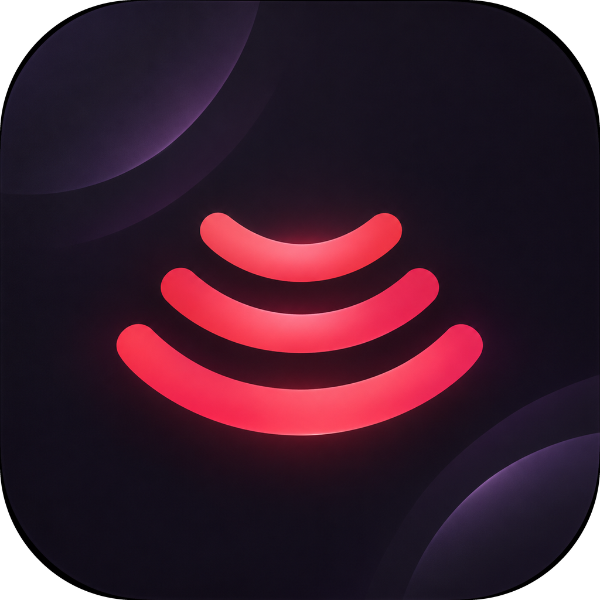
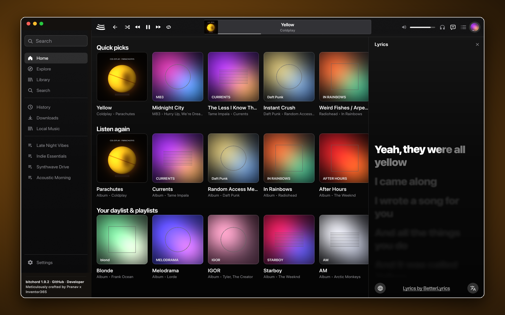
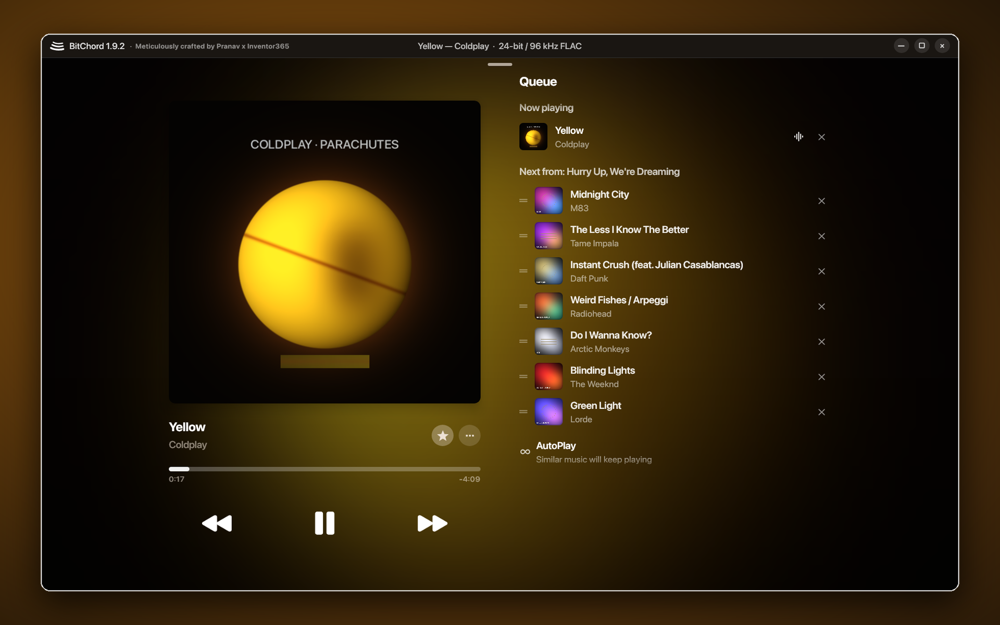
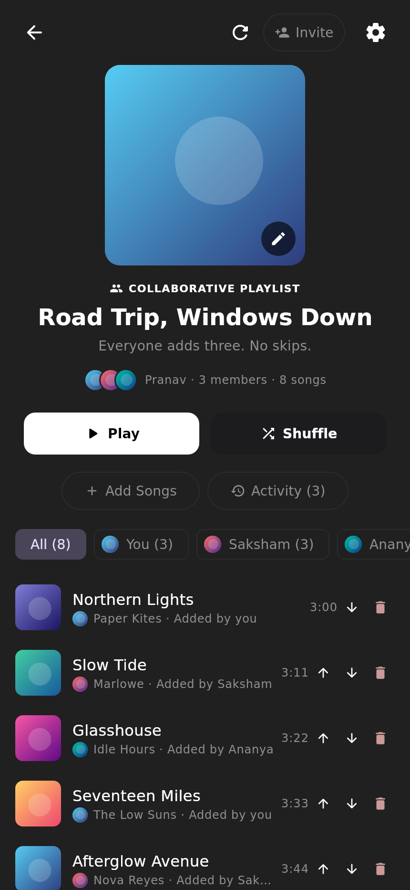
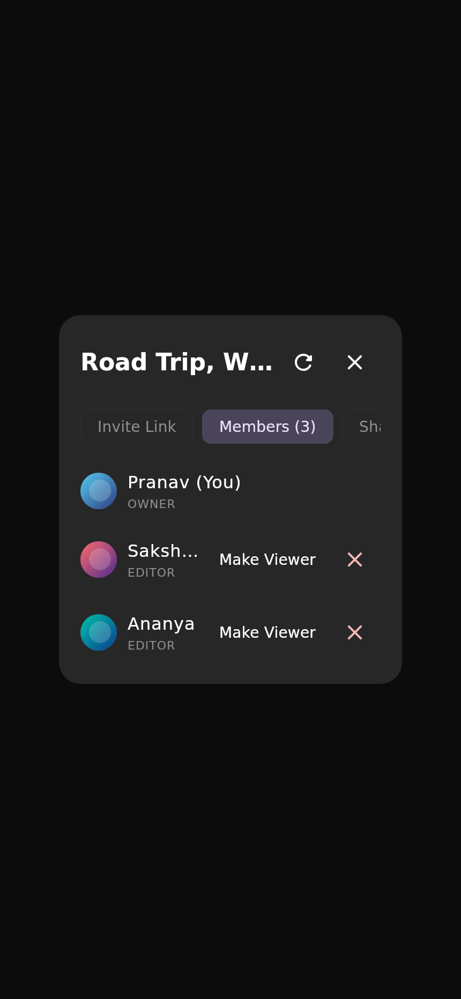
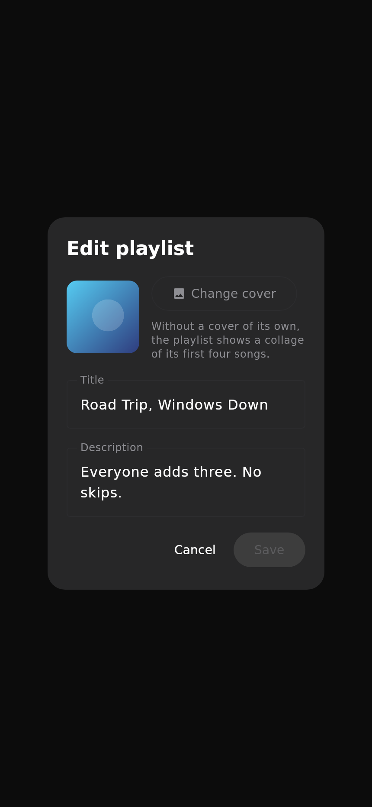

<div align="center">

<br/>



# BitChord PlusPC (`v1.10.1`)

### Multiplatform Music Client with Native Desktop, Collaborative Playlists & Lossless Audio
**Android · Android Auto · Android TV · Wear OS · macOS · Windows · Linux · Web**

<br/>

[](https://github.com/Inventor365/BitChord-PlusPC/releases/latest)
[](https://github.com/Inventor365/BitChord-PlusPC/blob/main/LICENSE)
[](https://github.com/Inventor365/BitChord-PlusPC/releases)

<br/>

[**Overview**](#1-project-overview) · [**Why PlusPC**](#2-why-bitchord-pluspc-exists) · [**Install**](#4-installation-instructions) · [**Collaborative Playlists**](#9-collaborative-playlists--contributor-attribution) · [**Build from Source**](#13-building-from-source) · [**Backend**](#15-backend-configuration) · [**Signing & Releases**](#16-release-and-signing-information) · [**Troubleshooting**](#18-troubleshooting) · [**Credits**](#19-credits-and-license)

</div>

> [!IMPORTANT]
> BitChord PlusPC is an independent, GPLv3-licensed open-source audio client. It is not affiliated with, endorsed by, or connected to YouTube, Google, Apple, or Spotify.

---

<div align="center">


<br/><br/>

<table>
  <tr>
    <td width="50%" align="center">
      
      <br/>
      <sub><b>macOS (Apple Silicon & Intel)</b> — Native traffic-light toolbar, Home shelves & word-synced lyrics side panel</sub>
    </td>
    <td width="50%" align="center">
      
      <br/>
      <sub><b>Linux & Windows</b> — Full-window landscape Now Playing with motion canvas, mesh backdrop & live queue</sub>
    </td>
  </tr>
</table>

<br/>

<table>
  <tr>
    <td width="33%" align="center">
      
      <br/>
      <sub><b>Collaborative playlists</b> — who added what, per-person filters, reorder and remove</sub>
    </td>
    <td width="33%" align="center">
      
      <br/>
      <sub><b>Invite & members</b> — share one link, see everyone who joined</sub>
    </td>
    <td width="33%" align="center">
      
      <br/>
      <sub><b>Make it yours</b> — title, description and a cover of your own</sub>
    </td>
  </tr>
</table>

</div>

---

## 1. Project Overview

**BitChord PlusPC** is a cross-platform YouTube Music and local/lossless audio player built with Kotlin Multiplatform, Compose Multiplatform, Media3, C++/ONNX DSP, React 19, and Go. It pairs an Apple Music–inspired Liquid Glass interface with word-by-word karaoke lyrics, Beat This! (`final0`) DJ Automix transitions, synchronized **Listen Together** rooms, and first-party **Collaborative Playlists** with verified Google contributor attribution.

---

## 2. Why BitChord PlusPC Exists

BitChord PlusPC builds upon Kushagra Singh's upstream [`kushagrasinghx/BitChord`](https://github.com/kushagrasinghx/BitChord) while maintaining capabilities that specifically extend or diverge from upstream:

### PlusPC-Specific Capabilities
- **Native Desktop Applications (`:desktopApp` & `:desktopUi`)**: First-class native installers and portable bundles for **macOS (`arm64` & `x64` `.dmg`, `.pkg`, `.zip`)**, **Windows (`x64` `.exe`, `.msi`, `-portable.zip`)**, and **Linux (`x86_64` `.AppImage`, `.deb`, `.rpm`)** with native OS media integration (`SMTC`, `MPRIS2`, macOS Now Playing), 10-band parametric EQ, Discord IPC Rich Presence, and local ONNX Automix analysis.
- **First-Party Collaborative Playlists & Contributor Attribution**: Server-authoritative shared playlists across Android, Desktop, and Web with verified Google OpenID Connect (RS256 + OAuth 2.0 PKCE) identity, non-destructive `"Make Collaborative"` personal playlist conversion, granular owner/editor/viewer roles, revocable `bci_...` invite links, live `/ws/collab` WebSocket sync, and Spotify Blend–style per-track contributor avatars.
- **Curated Upstream & Community PR Integration**: Integrates **85+ verified community pull requests** ahead of upstream releases (including authenticated 256 kbps Premium audio selection, Song Credits, Album/Artist play counts, resumable HTTP `Range` OTA downloads, portable `.csv`/`.m3u`/`.json` playlist exchange, and Web MediaSession/accessibility improvements).
- **Dedicated PlusPC Release & OTA Pipeline**: Deterministic Android signing (`SHA-256: d6d9c697...`) and verified macOS UDIF/XAR packaging (`scripts/macos/`) served exclusively from [`Inventor365/BitChord-PlusPC`](https://github.com/Inventor365/BitChord-PlusPC) and [`Inventor365/Bitchord-OTA`](https://github.com/Inventor365/Bitchord-OTA).

### Upstream Core Capabilities (from `kushagrasinghx/BitChord`)
- Liquid Glass UI, 3D gyroscope cover tilt, dynamic artwork mesh gradients, and 19-language localization.
- Media3/ExoPlayer streaming via InnerTubeX + NewPipe fallback, USB Audio Class 1.0/2.0 bit-perfect DAC output, and Hi-Res FLAC/Dolby Atmos module support.
- 12 word- and line-synced lyrics providers (`lrc.red`, `BiniLyrics`, `BetterLyrics`, `PaxSenix`, `LyricsPlus`, `SimpMusic`, `Unison`, `Megalobiz`, `KuGou`, `LRCLIB`, `Musixmatch`, `Genius`) with live translation and 18-script romanization.
- Android Auto, Android TV / Fire TV leanback interface, Wear OS companion remote, and Listen Together party sync.

---

## 3. Supported Platforms

| Platform | Architectures | Artifacts on [GitHub Releases (`v1.10.1`)](https://github.com/Inventor365/BitChord-PlusPC/releases/latest) |
| :--- | :--- | :--- |
| **Android Phone, Tablet & Auto** | Universal, `arm64-v8a`, `armeabi-v7a`, `x86_64` | `BitChord-v1.10.1.apk`, `BitChord-v1.10.1_<abi>.apk` |
| **Android TV / Fire TV** | Universal, `arm64-v8a`, `armeabi-v7a`, `x86_64` | `BitChordTV-v1.10.1.apk`, `BitChordTV-v1.10.1_<abi>.apk` |
| **Wear OS 3+** | Universal (`arm64-v8a`, `armeabi-v7a`) | `BitChordWear-v1.10.1.apk` *(also embedded inside the Phone APK)* |
| **macOS 12+** | Apple Silicon (`arm64`) & Intel (`x64`) | `BitChord-1.10.1-macos-{arm64,x64}.{dmg,pkg,zip}` |
| **Windows 10 / 11** | `x64` | `BitChord-1.10.1-windows-x64-setup.exe`, `.msi`, `-portable.zip` |
| **Linux** | `x86_64` / `amd64` | `BitChord-1.10.1-linux-x86_64.AppImage`, `-linux-amd64.deb`, `-linux-x86_64.rpm` |
| **Web & Extension** | Chrome / Chromium (MV3) & Firefox | `web/app/` SPA + `web/extension/` companion extension |
| **Backend Server** | Go 1.27+ (`linux/amd64`, `linux/arm64`, Docker) | `backend/` (Listen Together + Presence + Collaborative Playlists) |

---

## 4. Installation Instructions

### Android (Phone, Android Auto, Android TV & Wear OS)
1. Download `BitChord-v1.10.1.apk` (universal) or the matching ABI split (`arm64-v8a` for modern phones) from [Releases](https://github.com/Inventor365/BitChord-PlusPC/releases/latest).
2. Open the APK and allow installation from your browser/file manager if prompted.
3. **Android TV**: Install `BitChordTV-v1.10.1.apk` via Downloader, LocalSend, or `adb install -r BitChordTV-v1.10.1.apk`.
4. **Wear OS**: Open **Settings → Wear OS** in the BitChord phone app to push the bundled watch app over Wi-Fi debugging, or run `adb -s <watch-ip>:<port> install -r BitChordWear-v1.10.1.apk`.

### macOS (`.dmg`, `.pkg`, and `.zip`)
1. Pick **`arm64`** for Apple Silicon (`M1`/`M2`/`M3`/`M4`) or **`x64`** for Intel Macs:
   - **`.dmg` (Recommended)**: Open `BitChord-1.10.1-macos-<arch>.dmg` and drag **BitChord** to **Applications**.
   - **`.pkg` (Installer)**: Open `BitChord-1.10.1-macos-<arch>.pkg` and follow the macOS Installer wizard to install `/Applications/BitChord.app`.
   - **`.zip` (Portable)**: Extract `BitChord-1.10.1-macos-<arch>.zip` and move `BitChord.app` to `/Applications`.
2. **First Launch (Unsigned Build Note)**: Community builds are ad-hoc Mach-O signed (`LC_CODE_SIGNATURE`) and not Apple-notarized. If macOS Gatekeeper blocks the first launch, right-click `BitChord.app` → **Open**, or run:
   ```bash
   xattr -cr /Applications/BitChord.app
   ```

### Windows
- **Installer (`.exe` / `.msi`)**: Run `BitChord-1.10.1-windows-x64-setup.exe` or `BitChord-1.10.1-windows-x64.msi`.
- **Portable (`.zip`)**: Extract `BitChord-1.10.1-windows-x64-portable.zip` anywhere and launch `BitChord\BitChord.exe`.

### Linux
- **AppImage (Universal)**:
  ```bash
  chmod +x BitChord-1.10.1-linux-x86_64.AppImage
  ./BitChord-1.10.1-linux-x86_64.AppImage
  ```
- **Debian / Ubuntu (`.deb`)**: `sudo apt install ./BitChord-1.10.1-linux-amd64.deb`
- **Fedora / RHEL / openSUSE (`.rpm`)**: `sudo dnf install ./BitChord-1.10.1-linux-x86_64.rpm`

### Web App & Companion Browser Extension
```bash
cd web
corepack pnpm install --frozen-lockfile
corepack pnpm --filter @bitchord/extension build   # Load web/extension/.output/chrome-mv3 as unpacked extension
corepack pnpm --filter @bitchord/app dev           # Launch Web player at http://localhost:5173
```

---

## 5. Updating Safely Without Losing Data

- **In-App OTA Updates**: Android Phone, Android TV, and Desktop check `Inventor365/Bitchord-OTA` / GitHub Releases on launch. Android downloads updates with **HTTP `Range` resume support** and hands the verified APK directly to the system installer.
- **Permanent Release Signing Identity (`v1.10.0+`)**: Starting with `v1.10.0`, all `Inventor365/BitChord-PlusPC` releases are signed with one permanent RSA-4096 certificate (`SHA-256: d6d9c697c070a5ca5f4e172a13b6263fe2f3a35fff5d110596509126320c3bb2`) persisted in GitHub Actions Secrets (`KEYSTORE_BASE64`), so all future updates install seamlessly in place (`adb install -r` / in-app OTA) while preserving playlists, downloads, EQ presets, and sessions.
- **One-Time Migration Note**: Earlier pre-`v1.10.0` builds (`v1.8.1`, `v1.9`, `v1.9.2`) and upstream `kushagrasinghx/BitChord` builds used distinct signing keys (see [`docs/SIGNING.md`](docs/SIGNING.md)). Export any local playlists (`.m3u` / `.json`) before performing the one-time clean install to `v1.10.0`.

---

## 6. Feature Highlights

- **Lossless & Bit-Perfect Playback**: YouTube Music (`256 kbps` authenticated Premium AAC/Opus + NewPipe fallback), FLAC/ALAC/Dolby Atmos module sources, USB DAC exclusive mode on Android, and native desktop audio pipelines.
- **Automix & Loop Mix**: Beat-grid, phrase, vocal, and harmonic key transitions powered by Beat This! (`final0`) ONNX + Signalsmith stretch.
- **Word-Synced Lyrics**: 12 providers, syllable glow sweep, duet alignment, live translation, 18-script romanization, and local MP3 (`USLT`) / FLAC / M4A / WebM embedded tag support.
- **Animated Album Canvas**: Apple Music editorial motion artwork and Spotify Canvas with smooth swipe crossfades.
- **Scrobbling & Presence**: Last.fm, ListenBrainz, and Discord Rich Presence across Android, Desktop, and Web.

---

## 7. Playlist Management

BitChord PlusPC organizes playlists cleanly inside **Library** across Android, Desktop, and Web:
- **Collaborative Playlists**: Playlists you created or converted for shared editing.
- **Shared with Me**: Collaborative playlists you joined via invite link as an **Editor** or **Viewer**.
- **My Playlists & On Device**: Your personal YouTube Music, local/offline, and imported Spotify playlists, with pinning, custom cover upload, drag-to-reorder, duplicate detection, inline library search, and portable `.csv` / `.m3u` / `.json` exchange.

---

## 8. Google Authentication & Guest Mode

- **Guest Mode Works Out of the Box**: You can search, stream, manage local playlists, download offline tracks, and use Listen Together without signing into any account.
- **YouTube Music Account Sign-In**: Optional browser/WebView/cookie sign-in unlocks personal YouTube Music library shelves, Liked Music sync, and 256 kbps Premium streams.
- **Verified Google OIDC for Collaborative Playlists**: Collaborative features authenticate via **Google OpenID Connect** (Google Identity Services ID tokens on Web; OAuth 2.0 Authorization Code + **PKCE S256** browser/loopback flow on Android & Desktop). BitChord never asks for or stores Google passwords, and never accepts unverified self-declared identities.

---

## 9. Collaborative Playlists & Contributor Attribution

See **[`docs/COLLABORATIVE_PLAYLISTS.md`](docs/COLLABORATIVE_PLAYLISTS.md)** for full protocol and API documentation:
- **Convert Any Personal Playlist ("Make Collaborative")**: Open the menu (`•••`) on any YouTube Music, local, Desktop, or Spotify playlist and choose **Make Collaborative**. Your original personal playlist remains untouched while a live collaborative playlist is created with all existing songs attributed to you.
- **Shareable, Revocable Invitations**: Generate `bci_<token>` links granting **Editor** or **Viewer** access with configurable expiration (`24h`, `7 days`, `Never`) and optional max uses. Preview invites while logged out; revoke any link immediately.
- **Granular Permissions & "Stop Sharing"**: Restrict editors to removing only songs they added (`editorCanRemove = "own"`), toggle track reordering or invite privileges, transfer ownership, or choose **Stop Sharing (Make Private)** to revoke collaborator access while preserving your playlist and historical contributor attribution.

---

## 10. Contributor Attribution

Every track added to a collaborative playlist is stamped **server-side** from the authenticated user's verified Google profile:
- Displays a circular contributor avatar (or initials badge) beside the artist credit (`"Added by you"` or `"Added by <Display Name>"`).
- Filter any collaborative playlist by contributor in one tap, and inspect the lightweight **Recent Activity** feed (`"Saksham added Midnight City"`, role updates, joins).

---

## 11. Listen Together

**Listen Together** provides real-time synchronized playback rooms (`party/` on `backend/`) with 6-character room codes, QR/link invites, host playback lock or open guest queue contributions, live latency-compensated clock sync, and swipe-to-reply room chat — completely independent of Collaborative Playlists so either feature works with or without the other.

---

## 12. Upstream Project & Attribution

BitChord PlusPC is an actively maintained fork of **[`kushagrasinghx/BitChord`](https://github.com/kushagrasinghx/BitChord)** created by **[Kushagra Singh](https://bitchord.kushagrasingh.in/)**. Every integrated upstream commit and community pull request preserves original contributor credit — see **[`CHANGELOG.md`](CHANGELOG.md)** for PR-by-PR attribution.

---

## 13. Building from Source

```bash
git clone https://github.com/Inventor365/BitChord-PlusPC.git
cd BitChord-PlusPC

# 1. Run shared KMP, Desktop, Android Phone, and Android TV unit tests
./gradlew :shared:jvmTest :sharedUi:jvmTest :desktopUi:jvmTest :desktopApp:test :app:testDevDebugUnitTest :tv:testDevDebugUnitTest

# 2. Build Android debug APKs
./gradlew :app:assembleDevDebug :tv:assembleDebug :wearos:assembleDevDebug

# 3. Run or package Desktop app (Linux / macOS / Windows)
./gradlew :desktopApp:run
./gradlew :desktopApp:createDistributable

# 4. Build & test Web app + Extension
(cd web && corepack pnpm install --frozen-lockfile && corepack pnpm -r typecheck && corepack pnpm -r test && corepack pnpm --filter @bitchord/app build)

# 5. Build & test Go Backend
(cd backend && go vet ./... && go test -race ./... && go build -o bitchord-backend .)
```

---

## 14. Development Environment

- **JDK**: Eclipse Temurin **21** (required for Gradle + `jpackage`; targets JVM 17 bytecode).
- **Android SDK / NDK**: `compileSdk 37`, `targetSdk 36`, `minSdk 26`, CMake `3.22.1+`, Android NDK.
- **Node / pnpm**: Node.js `22+` with `corepack enable` (`pnpm 12.x`).
- **Go**: Go `1.27+` (`backend/`).

Optional `local.properties` keys (never committed):
```properties
LISTEN_TOGETHER_SERVER=https://your-backend.example.com
COLLAB_SERVER=https://your-backend.example.com
COLLAB_GOOGLE_CLIENT_ID=your-client-id.apps.googleusercontent.com
LASTFM_API_KEY=...
LASTFM_SECRET=...
```

---

## 15. Backend Configuration

`backend/` is a single self-contained Go binary serving Listen Together (`/ws`, `/invite/`), Presence (`/api/stats/`), and Collaborative Playlists (`/api/collab/*`, `/ws/collab`, `/collab/invite/`):

```bash
cd backend
COLLAB_DATA_PATH=./data/collab.json \
COLLAB_GOOGLE_CLIENT_IDS="your-web-or-desktop-client-id.apps.googleusercontent.com" \
ALLOWED_ORIGINS="https://your-web-origin.example.com" \
PORT=8080 \
go run .
```

See [`docs/COLLABORATIVE_PLAYLISTS.md`](docs/COLLABORATIVE_PLAYLISTS.md) and [`backend/README.md`](backend/README.md) for reverse-proxy (`Caddyfile`), TLS, and systemd deployment (`bitchord-party.service`).

---

## 16. Release and Signing Information

- **Android Signing & Upgrade Verification**: Documented in **[`docs/SIGNING.md`](docs/SIGNING.md)** and enforced by `scripts/verify-android-upgrade.sh`.
- **macOS DMG & PKG Packaging**: Documented in **[`docs/MACOS_PACKAGING.md`](docs/MACOS_PACKAGING.md)** and verified by `scripts/macos/verify-macos-artifacts.py`.
- **Cross-Platform Release Checklist**: Documented in **[`docs/RELEASE_PROCESS.md`](docs/RELEASE_PROCESS.md)**.

---

## 17. Known Limitations

- **macOS Notarization**: Without paid Apple Developer ID credentials configured in CI secrets, macOS `.dmg` / `.pkg` / `.zip` builds use ad-hoc Mach-O code signatures and require a one-time right-click → **Open** (or `xattr -cr /Applications/BitChord.app`) on first launch.
- **Collaborative Playlists Server Requirement**: Collaborative Playlists require a reachable BitChord backend instance (`COLLAB_SERVER` / Settings → Collaboration Server URL) and a Google OAuth 2.0 Client ID configured on both server and client.
- **Upstream APK Key Difference**: Switching between `kushagrasinghx/BitChord` and `Inventor365/BitChord-PlusPC` on Android requires a one-time clean install due to distinct author signing certificates.

---

## 18. Troubleshooting

- **Android says `"App not installed as package conflicts with an existing package"`**: You have an APK signed with a different key installed (e.g. upstream `kushagrasinghx/BitChord` or a local debug build). Export any local playlists, uninstall the conflicting package once, and install the PlusPC release APK — future PlusPC updates will install in place cleanly.
- **macOS says `"BitChord is damaged and can't be opened"` or `"unidentified developer"`**: Run `xattr -cr /Applications/BitChord.app` in Terminal after dragging `BitChord.app` to `/Applications`.
- **Collaborative Sign-In says `"Configure Collaboration Server URL / Google Client ID"`**: Open **Library → Collab Account** (or **Settings → Collaborative Playlists** on Web) and enter your backend HTTPS URL and Google OAuth Client ID.
- **Linux AppImage does not launch on Ubuntu 24.04+**: Install FUSE2 (`sudo apt install libfuse2t64`) or run with `--appimage-extract-and-run`, or install the native `.deb` package instead.

---

## 19. Credits and License

- **BitChord PlusPC Engineering & Maintenance**: **Pranav × [`@Inventor365`](https://github.com/Inventor365)** — native Desktop restoration & packaging (`macOS`, `Windows`, `Linux`), Collaborative Playlists & Google OIDC architecture, deterministic signing/verification pipeline, and upstream PR curation.
- **Original Author & Upstream Creator**: **[Kushagra Singh (`@kushagrasinghx`)](https://bitchord.kushagrasingh.in/)** — creator of [`kushagrasinghx/BitChord`](https://github.com/kushagrasinghx/BitChord), Liquid Glass UI, Automix engine, and Android/TV/Wear/Web foundations.
- **Lyrics & Ecosystem Acknowledgements**: **[binimum (`am-lyrics`)](https://github.com/binimum/am-lyrics)** and all upstream open-source contributors credited in [`CHANGELOG.md`](CHANGELOG.md).

Licensed under the **GNU General Public License v3.0 (GPLv3)** — see [`LICENSE`](LICENSE).
