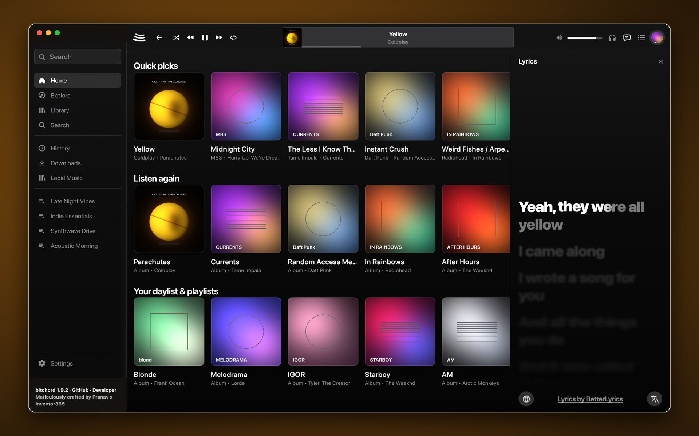
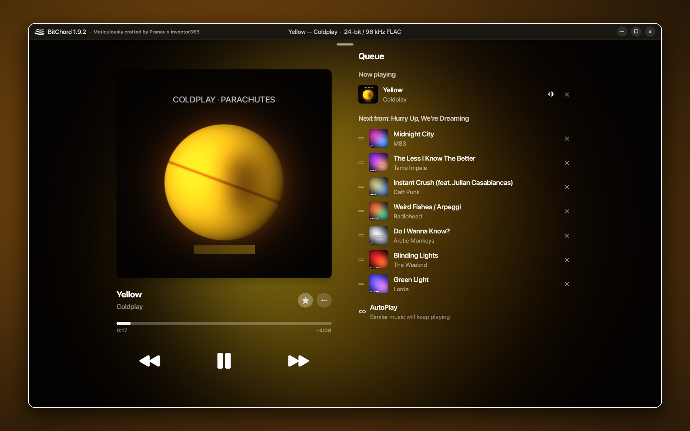

 
 

# BitChord PlusPC (`v1.9.2`)

### Aesthetic YouTube Music Client for Windows, macOS, Linux, Android, Android Auto, Android TV & Wear OS

 

 

[**Download**](#download) · [**What's New in v1.9.2**](#whats-extra) · [**Features**](#features) · [**Desktop**](#desktop) · [**Contributing**](#contributing) · [**Credits**](#credits) · [**Disclaimer**](#disclaimer)

 

> [!IMPORTANT]
> BitChord is not affiliated with, endorsed by, or connected to YouTube or Google in any way. Use it at your own discretion.

---

 
 

<table>
  <tr>
    <td width="50%" align="center">
      
       
      <b>macOS (Apple Silicon & Intel)</b> — Native traffic-light toolbar, Home shelves & word-synced lyrics side panel
    </td>
    <td width="50%" align="center">
      
       
      <b>Linux & Windows</b> — Full-window landscape Now Playing with motion canvas, mesh backdrop & live queue
    </td>
  </tr>
</table>

---

<h1>Download (`v1.9.2`)</h1>

  
  &nbsp;
  
  &nbsp;
  
  &nbsp;
  

| Platform | Architectures | Packages on [Releases (`v1.9.2`)](https://github.com/Inventor365/BitChord-PlusPC/releases/latest) |
| :--- | :--- | :--- |
| **Android (Phone, Tablet & Auto)** | Universal, `arm64-v8a`, `armeabi-v7a`, `x86_64` | `BitChord-v1.9.2.apk`, `BitChord-v1.9.2_<abi>.apk` |
| **Android TV / Fire TV** | Universal, `arm64-v8a`, `armeabi-v7a`, `x86_64` | `BitChordTV-v1.9.2.apk`, `BitChordTV-v1.9.2_<abi>.apk` |
| **Wear OS** | Universal | `BitChordWear-v1.9.2.apk` (also embedded in the phone APK) |
| **Windows 10 / 11** | `x64` | `BitChord-1.9.2-windows-x64-setup.exe`, `.msi`, `-portable.zip` |
| **macOS 12+** | Apple Silicon (`arm64`) & Intel (`x64`) | `BitChord-1.9.2-macos-arm64.dmg` / `.pkg` / `.zip`, `macos-x64.dmg` / `.pkg` / `.zip` |
| **Linux** | `x86_64` / `amd64` | `BitChord-1.9.2-linux-x86_64.AppImage`, `-linux-amd64.deb`, `-linux-x86_64.rpm` |

For detailed desktop build and packaging instructions, see [DESKTOP.md](DESKTOP.md).

---

<h1>What's Extra Over Official (`v1.9.2`)</h1>

This repository syncs [`kushagrasinghx/BitChord`](https://github.com/kushagrasinghx/BitChord) (**`v1.9.1`** + `web-player`) while restoring and hardening the native **Windows, macOS, and Linux** desktop client, integrating **80+ verified community pull requests** ahead of upstream, and shipping a dedicated OTA update channel (`Inventor365/Bitchord-OTA` & `Inventor365/BitChord-PlusPC`):

- **Native Desktop Client Restored & Hardened (`:desktopApp` & `:desktopUi`)**:
  - Verified native packages for **Windows (`x64` `.exe`, `.msi`, `-portable.zip`)**, **macOS (`arm64` & `x64` `.dmg`, `.pkg`, `.zip`)**, and **Linux (`x86_64` `.AppImage`, `.deb`, `.rpm`)** with full UDIF `koly`/`blkx` CRC-32 validation, XAR raw-`zlib` (`0x78 0xda`) streams, `Bom` verification, and ad-hoc Mach-O `LC_CODE_SIGNATURE` + `_CodeSignature/CodeResources` SHA-256 seals.
  - Native audio output (`WASAPI`, `CoreAudio`, `ALSA`/`PulseAudio`/`PipeWire`), 10-band parametric EQ, system media integration (`SMTC`, `MPRIS2`, macOS Now Playing), Discord Rich Presence IPC, and local Beat This! (`final0`) ONNX Automix analysis.
  - **Easy Browser Sign-In Link & Universal Session Paste**: Copyable & one-click browser sign-in links for **YouTube Music (Google)** and **Spotify**, one-click browser profile import across Windows, macOS (Keychain), and Linux, plus a **Universal Smart Paste / Paste from Clipboard** flow that accepts DevTools Cookies table rows (`Ctrl+A`, `Ctrl+C`), *Copy as cURL* (Bash/CMD), *Copy as PowerShell*, *Copy as fetch*, Cookie-Editor JSON, Netscape `cookies.txt`, or raw cookie headers.
- **Android Auto, 3D Album Cover Tilt & Dynamic Cover App Icon (`v1.9.1`)**:
  - Full **Android Auto** support with Quick Picks, Listen Again, Favorites, Offline Library, Playlists, Albums, Artists, voice search, and full Automix transitions in the car.
  - **3D Album Cover Tilt** driven by the device gyroscope, **Dynamic App Icon** that adopts the currently playing song's cover art on the home screen, and **Audio Output Switcher** directly on the Android 13+ media notification.
  - **Playlist Search & Sort** (Recently Added, Title, Artist, Album, Duration, Custom), **Local Albums / Artists / Artist pages**, **Multi-Select in Local Library & Downloads**, and **Swipe-to-Reply** in Listen Together chat.
- **58+ Newly Integrated Community PRs (`v1.9.2`)**:
  - **Parametric EQ Import/Export & Headphone Presets (`#1391`)**, **Separate Pitch & EQ Controls (`#1426`)**, and **Cast Audio Effects Notice (`#1392`, `#1400`)**.
  - **Auto-Pause on Zero Volume (`#1396`)**, **Bluetooth Reconnect Auto-Resume (`#1395`)**, and **Pocket Hardware Volume Lock (`#1369`)**.
  - **Remember Song/Video Choice (`#1437`)**, **Cast Queue Sync & Artwork (`#1510`)**, and **Resilient Queue Auto-Skip (`#1446`, `#1484`, `#1487`, `#1489`, `#1491`)**.
  - **12 Lyrics Providers (`lrc.red`, `LyricsPlus` `#1240`, `SimpMusic` `#1250`, `BiniLyrics`, `BetterLyrics`, `PaxSenix`, `Unison`, `Megalobiz`, `KuGou`, `LRCLIB`, `Musixmatch`, `Genius`)** with **Fullscreen Translation/Romanization (`#1308`–`#1311`)**, **Word-Tap Seek (`#1447`–`#1449`)**, and **18-Script Romanization** (Cyrillic, Devanagari, Bengali, Gurmukhi, Tamil, Telugu, Kannada, Malayalam, Gujarati, Odia, Sinhala, Thai, Lao, Khmer, Myanmar, Japanese, Korean, Chinese).
  - **M3U / JSON Playlist Export & Import (`#1386`, `#1389`)**, **Duplicate Track Detection (`#1399`)**, **Custom Playlist Cover Art (`#1436`, `#1438`)**, **Smart Offline Mode (`#1359`, `#1361`)**, and **Local Folder Tree & Tag Editing (`#1505`–`#1515`)**.
  - **Material You Dynamic Accent (`#1478`, `#1480`, `#1482`)**, **Resizable Glance & Turntable Widgets (`#1523`, `#1525`)**, **Android TV D-Pad & Screensaver Polish (`#1554`, `#1558`, `#1560`)**, **Wear OS Standalone Tile & Rotary Crown Volume (`#1570`, `#1573`)**, and **19 Languages** (including Arabic `ar` & Vietnamese `vi`).

---

<h1>Features</h1>

<table>
  <tr>
    <td width="50%" valign="top">

#### Playback & Audio Engine
- **Search, browse and play** anything available on YouTube Music — songs, albums, playlists, podcasts, artists, and full **music videos up to 4K**.
- **Hi-Res lossless & Bit-Perfect audio** — FLAC/ALAC/Dolby Atmos from configured module/addon/Debrid sources, with Android 14 USB mixer bypass, AAudio exclusive DAP mode, and custom USB Audio Class 1.0/2.0 driver.
- **Gapless playback with true crossfade**, adjustable 0–12s.
- **Automix & Loop Mix** — Beat-matched, key-aware, and vocal-aware DJ transitions powered by Beat This! (`final0`) and Signalsmith time-stretching, with an interactive Mix View popup and Android Auto support.
- **Offline downloads & Offline Player** — Save tracks with embedded metadata/lyrics, assemble DASH/HLS manifests into `.flac`, sync downloaded playlists in the background, and browse local folders, albums, and artists offline.
- **Open links from other apps** — Spotify, Apple Music, Deezer and SoundCloud track, album and playlist links play here, matched on YouTube Music.
- **Save queue & radio as playlist** — Turn any queue or radio station into a saved playlist, or export/import playlists as `.m3u` / `.json`.

#### Connectivity & Accounts
- **Sign in with your Google account** (including brand channels) for personalized content and library sync.
- **Android Auto** — Browse and play your library, playlists, and Automix queues directly from your car's head unit.
- **Listen Together** — Synchronized listening parties with host controls, QR/link invites, swipe-to-reply chat, and live activity feed.
- **Spotify integration** — Connect your account to play and import your playlists and Liked Songs.
- **Discord Rich Presence** — Live track, artist, album art, audio quality badge, and seek-accurate progress on Android, Desktop, and Web.
- **Scrobbling** to Last.fm and ListenBrainz.

    </td>
    <td width="50%" valign="top">

#### Experience & Design
- **Liquid Glass UI** — Apple-inspired Liquid Glass bars with edge refraction, adaptive glyph contrast, progressive status-bar blur, 3D gyroscope cover tilt, and squircle segmented tabs.
- **Animated album canvas** — 3:4 motion artwork on mobile and square motion sleeves on desktop/landscape.
- **Apple-like word-synced lyrics** — Syllable/word-level sweep, duet alignment, live translation, 18-script Romanization, and Vazirmatn Persian font support. Credit to [binimum](https://github.com/binimum/am-lyrics).
- **12 Lyrics providers** — [lrc.red](https://lrc.red), [BiniLyrics](https://github.com/binimum), [BetterLyrics](https://github.com/better-lyrics/better-lyrics), [PaxSenix](https://lyrics.paxsenix.org), [LyricsPlus](https://github.com/ibratabian17/YouLyPlus), [SimpMusic](https://github.com/maxrave-dev/SimpMusic), [Unison](https://unison.boidu.dev), [Megalobiz](https://www.megalobiz.com), [KuGou](https://www.kugou.com), [LRCLIB](https://lrclib.net), [Musixmatch](https://www.musixmatch.com), and [Genius](https://genius.com), plus embedded ID3/FLAC tags.
- **Dynamic artwork-driven theming** — Real-time mesh gradient backdrops extracted from cover art, optional Material You accent, and Dynamic Now Playing app icon.
- **19 Languages** — Arabic, Vietnamese, English, German, Spanish, French, Hebrew, Hindi, Indonesian, Italian, Japanese, Korean, Polish, Portuguese, Russian, Thai, Turkish, Simplified Chinese, and Traditional Chinese.

#### Controls, Hardware & Tweaks
- **Galaxy Buds & Hi-Res Bluetooth** — Built-in Galaxy Buds noise/EQ/battery panel, 24-bit float Bluetooth preservation, Bluetooth reconnect auto-resume, and USB DAC bit-perfect mode.
- **Per-network audio quality** — Separate quality ceilings for Wi-Fi and mobile data, plus Direct Source Stream mode.
- **Playback speed & pitch control** (0.5×–2.0×), **skip silence**, **zero-volume auto-pause**, and **pocket volume lock**.
- **Custom sleep timer** — 5 minutes to 12 hours, or "stop after this track".
- **Parametric Equalizer & Limiter** — System & built-in multiband/parametric EQ with preset import/export and peak limiting.
- **Stats for nerds** — Live codec, bit depth, sample rate, source name, and waveform alignment offset on the player.

    </td>
  </tr>
</table>

---

<h1>Contributing</h1>

We welcome contributions to BitChord! Please review our [Contributing Guide](CONTRIBUTING.md) and [Code of Conduct](CODE_OF_CONDUCT.md) before submitting a Pull Request.

[**Contributing Guide**](CONTRIBUTING.md) · [**Code of Conduct**](CODE_OF_CONDUCT.md) · [**Maintainers**](MAINTAINERS.md) · [**Additional Docs**](ADDITIONAL.md)

---

<h1>Credits & Acknowledgements</h1>

- **Meticulously Crafted & Maintained (`BitChord-PlusPC`)**: **Pranav x [`@Inventor365`](https://github.com/Inventor365)** — restoring, engineering, and maintaining the native Windows, macOS, and Linux desktop client (`:desktopApp` & `:desktopUi`), cross-platform packaging pipeline, and 80+ curated community enhancements.
- **Credits to Original Author**: **[Kushagra Singh (`@kushagrasinghx`)](https://bitchord.kushagrasingh.in/)** and the upstream **[kushagrasinghx/BitChord](https://github.com/kushagrasinghx/BitChord)** project for creating BitChord, its Apple Music-inspired Liquid Glass design system, Automix DSP engine, and mobile/TV/Wear OS foundations.
- **Lyrics & Visual Inspiration**: **[binimum (`am-lyrics`)](https://github.com/binimum/am-lyrics)** for Apple-style word-by-word synced lyrics design, and the open lyrics ecosystem ([lrc.red](https://lrc.red), [LRCLIB](https://lrclib.net), [BetterLyrics](https://github.com/better-lyrics/better-lyrics), [PaxSenix](https://lyrics.paxsenix.org), [BiniLyrics](https://github.com/binimum), [LyricsPlus](https://github.com/ibratabian17/YouLyPlus), [SimpMusic](https://github.com/maxrave-dev/SimpMusic), [Unison](https://unison.boidu.dev)).

### Thanks to all contributors ❤

---

<h1>Disclaimer & Legal Notice</h1>

BitChord is an independent, community-driven third-party audio player and client. It is **not** associated with Google LLC, YouTube Music, Deezer, Telegram, or any of their parent companies.

* **No Media Hosting:** BitChord does not host, upload, or store copyrighted music files. It operates strictly as an interface to scan local device storage or stream media directly from public, public-facing, or user-authenticated APIs.
* **Fair Use & API Usage:** This software is created solely for personal research, educational, and fair-use purposes. The user is entirely responsible for ensuring their usage aligns with their local copyright laws and YouTube Terms of Service.
* **No Ad-Blocking Guarantee:** While BitChord focuses on providing a clean listening environment, it does not guarantee permanent bypasses or modifications to commercial third-party platform conditions.
* **Copyleft:** BitChord is free software under the GPLv3. The license does not let anyone forbid others from selling or redistributing copies, but any distribution must come with the Corresponding Source under the same license.

---

<h1>License</h1>

This project is licensed under the **GNU General Public License v3.0 (GPLv3)**. See the [LICENSE](LICENSE) file for details.

