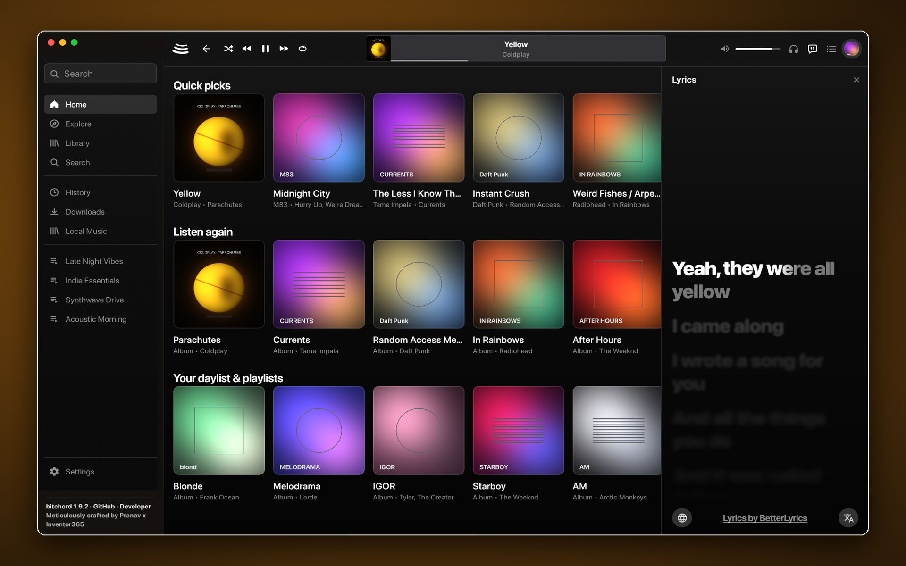
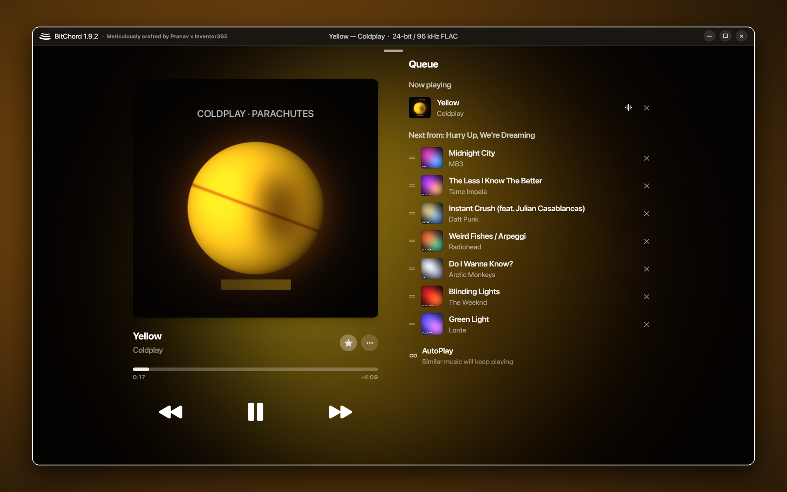

  
  

## What's New in `BitChord-PlusPC v1.9.2` (`versionCode = 40`)

*Meticulously crafted by **Pranav x [@Inventor365](https://github.com/Inventor365)** · [Credits to author](https://bitchord.kushagrasingh.in/)*

This release merges upstream **`v1.9.1`** (`acf219a7`) with **58 newly integrated community pull requests** (80+ total ahead of upstream), **re-engineered macOS, Windows, and Linux desktop installers**, an interactive **`bitchord 1.9.2` Settings Easter egg**, and a dedicated **OTA update channel** (`Inventor365/Bitchord-OTA` & `Inventor365/BitChord-PlusPC`).

---

### 1. Upstream `v1.9.1` Highlights (Merged Across Mobile, TV, Wear OS & Desktop)
- **Android Auto Integration**: Browse and play Quick Picks, Listen Again, Favorites, Offline Library, Playlists, Albums, and Artists directly from your car's head unit — with voice search, Like/Shuffle controls, and full **Automix** DJ transitions in the car.
- **Playlist Search & Sort**: Filter any playlist in place and sort by **Recently Added, Title, Artist, Album, Duration, or Custom**.
- **Local Albums, Artists & Artist Pages**: Offline Player now groups device audio into **Albums** and **Artists** tabs alongside Songs, Playlists, and Folders, with full local artist pages.
- **3D Album Cover Tilt & Dynamic Cover App Icon**: Optional gyroscope-driven 3D artwork tilt on the player (**Settings → Appearance → 3D Album Cover Tilt**) and **Dynamic App Icon** that adopts the currently playing song's cover art on the home screen.
- **18-Script Lyrics Romanization & `lrc.red` Primary Provider**: Added `lrc.red` for fast word-synced lyrics, plus transliteration for Belarusian, Bulgarian, Nepali, Kyrgyz, Mongolian, Punjabi, Bengali, Tamil, Telugu, Kannada, Malayalam, Gujarati, Marathi, Odia, Sinhala, Lao, Khmer, and Burmese alongside Russian, Ukrainian, Serbian, Japanese, Korean, Chinese, Hindi, and Thai.
- **Android 13+ Media Notification Output Switcher**: Switch between phone speaker, wired headphones, Bluetooth, and Cast directly from the media notification chip.
- **Multi-Select in Local Library & Downloads + Listen Together Swipe-to-Reply**: Long-press any local or downloaded track to batch play, queue, add to playlists, or delete; swipe any Listen Together chat message to reply in context.
- **Major Memory & Stability Fixes**: Bounded image caches, background album art eviction, and OOM fixes during long browsing sessions.

---

### 2. 58 Newly Integrated Community Pull Requests (`v1.9.2`)
- **Audio, Equalizer & Playback Controls**:
  - **Parametric EQ Import/Export & Headphone Preset Browser (`#1391`)**: Import/export parametric EQ configurations and browse headphone target presets.
  - **Separate Pitch Control & Equalizer from Speed Sheet (`#1426`)** + **Cast Audio Effects Notice (`#1392`, `#1400`)**.
  - **Auto-Pause on Zero Volume (`#1396`)**: Automatically pause playback when media volume reaches zero and optionally resume when raised.
  - **Resume Playback on Bluetooth Reconnect (`#1395`)**: Automatically resume playback when a Bluetooth audio device reconnects.
  - **Pocket Hardware Volume Button Lock (`#1369`)**: Optional setting to ignore accidental hardware volume presses when the screen is off.
  - **Remember Song / Video Choice (`#1437`)**: Remembers your preferred audio vs. music-video mode per track.
  - **Cast Queue Sync & Artwork (`#1510`)** and **Resilient Queue Auto-Skip (`#1446`, `#1484`, `#1487`, `#1489`, `#1491`)** so unavailable tracks never stall the queue.
  - **Audio Cache Eviction & Local Storage Playback Fixes (`#1323`, `#1366`)**.
- **Lyrics, Search & Discovery**:
  - **LyricsPlus (`#1240`) & SimpMusic (`#1250`) Lyrics Providers**: Expanded to 12 synced lyrics providers.
  - **Live Lyrics Translation & Romanization in Fullscreen Lyrics (`#1308`, `#1309`, `#1310`, `#1311`)**.
  - **Interactive Lyrics Word Tap & Timestamp Seek (`#1447`, `#1448`, `#1449`)** + **Apple Music Lyrics Glow & Blur Polish (`#1456`, `#1460`, `#1474`)**.
  - **In-Playlist & Local Song Search (`#1375`, `#1376`)**, **Top Picks & Moods Refresh (`#1378`, `#1380`, `#1381`, `#1383`)**, and **Full Artist Discography & Album Versions (`#1465`, `#1466`, `#1467`)**.
- **Library, Playlists & Downloads**:
  - **Export & Import Playlists as M3U / JSON (`#1386`, `#1389`)**.
  - **Batch Multi-Select in Playlists & Downloads (`#1469`, `#1470`)**.
  - **Duplicate Song Detection When Adding to Playlists (`#1399`)**.
  - **Custom Playlist Cover Art Upload (`#1436`, `#1438`)**.
  - **Smart Offline Mode Toggle (`#1359`, `#1361`)**.
  - **Local Folder Hierarchy, Album/Artist Grouping & Tag Editing (`#1505`–`#1509`, `#1511`, `#1513`–`#1515`)**.
- **UI, Widgets, TV, Wear OS & Localization**:
  - **Interactive `bitchord 1.9.2` Settings Footer Easter Egg**: Tap `bitchord 1.9.2` in Settings on Android, Desktop, or Android TV for rotating musical quotes and animated sound-wave celebrations, with updated `Inventor365/BitChord-PlusPC` links and author credits.
  - **Material You / Monet Dynamic Accent (`#1478`, `#1480`, `#1482`)** and **Resizable Glance & Turntable Widgets (`#1523`, `#1525`)**.
  - **Android TV D-Pad Focus, Lyrics & Screensaver Polish (`#1554`, `#1558`, `#1560`)**.
  - **Wear OS Standalone Tile & Rotary Crown Volume (`#1570`, `#1573`)**.
  - **19 Languages (`#1574`, `#1575`, `#1576`, `#1587`, `#1246`–`#1249`, `#1303`)**: Complete translations across Arabic (`ar`), Vietnamese (`vi`), German (`de`), Spanish (`es`), French (`fr`), Hebrew (`iw`), Hindi (`hi`), Indonesian (`in`), Italian (`it`), Japanese (`ja`), Korean (`ko`), Polish (`pl`), Portuguese (`pt-BR`), Russian (`ru`), Thai (`th`), Turkish (`tr`), Simplified Chinese (`zh-CN`), and Traditional Chinese (`zh-TW`).

---

### 3. Native Desktop Packaging & OTA Hardening
- **macOS (`arm64` Apple Silicon & `x64` Intel)**:
  - Fixed `DiskImageMounter: invalid checksum` on `.dmg` images by recomputing partition `blkx` (`mish`), Master, and Data Fork CRC-32 checksums in the UDIF `koly` trailer and validating HFS+ volumes with `fsck.hfsplus`.
  - Fixed `.pkg` XAR stream verification and Gatekeeper bundle validation by compressing `Bom`, `PackageInfo`, and `Distribution` with raw `zlib` (`0x78 0xda`), updating `Bom` sizes and POSIX `cksum`s, and sealing all 300 files in `_CodeSignature/CodeResources` plus Mach-O `LC_CODE_SIGNATURE` Special Slots `-1` and `-3` (verified with `rcodesign`).
- **Windows (`x64`) & Linux (`x86_64`)**:
  - Rebuilt `.msi`, `-setup.exe`, and `-portable.zip` for Windows 10/11 and `.AppImage`, `.deb`, and `.rpm` for Linux with native `libbitchord_analysis` and Beat This! (`final0`) ONNX models.
- **Dedicated `BitChord-PlusPC` OTA Updates**:
  - All platforms (`Android`, `Android TV`, `Windows`, `macOS`, `Linux`) fetch updates exclusively from `Inventor365/Bitchord-OTA` and `Inventor365/BitChord-PlusPC` and never poll the upstream repository.

---

## Installation Guide (`v1.9.2`)

### Android Phone, Tablet & Android Auto (Android 8.0 / API 26+)
- **Universal APK (Recommended)**: `BitChord-v1.9.2.apk` (works on all devices).
- **Per-ABI Splits (Smaller download)**:
  - `BitChord-v1.9.2_arm64-v8a.apk` — Modern 64-bit ARM phones & tablets.
  - `BitChord-v1.9.2_armeabi-v7a.apk` — Older 32-bit ARM devices.
  - `BitChord-v1.9.2_x86_64.apk` — Chromebooks & Android emulators.

### Android TV / Google TV / Fire TV (Android 8.0 / API 26+)
- **Universal TV APK**: `BitChordTV-v1.9.2.apk`
- **Per-ABI TV Splits**: `BitChordTV-v1.9.2_armeabi-v7a.apk` (most TVs & Fire TV sticks), `BitChordTV-v1.9.2_arm64-v8a.apk` (NVIDIA Shield, Google TV Streamer), `BitChordTV-v1.9.2_x86_64.apk`.

### Wear OS Companion
- **Watch APK**: `BitChordWear-v1.9.2.apk` (also bundled inside the phone APK for automatic companion installation).

### Windows (`x64`, Windows 10 / 11)
- **Installer (`.exe` / `.msi`)**: `BitChord-1.9.2-windows-x64-setup.exe` or `BitChord-1.9.2-windows-x64.msi`
- **Portable (`.zip`)**: `BitChord-1.9.2-windows-x64-portable.zip` — extract anywhere and run `BitChord.exe` (no installation required).

### macOS (`arm64` Apple Silicon & `x64` Intel, macOS 12+)
- **Apple Silicon (M1 / M2 / M3 / M4)**: `BitChord-1.9.2-macos-arm64.dmg` (or `.pkg` / `.zip`)
- **Intel Mac (`x86_64`)**: `BitChord-1.9.2-macos-x64.dmg` (or `.pkg` / `.zip`)

### Linux (`x86_64`)
- **AppImage (Universal)**: `BitChord-1.9.2-linux-x86_64.AppImage` (`chmod +x` and run directly)
- **Debian / Ubuntu / Mint**: `sudo apt install ./BitChord-1.9.2-linux-amd64.deb`
- **Fedora / RHEL / openSUSE**: `sudo dnf install ./BitChord-1.9.2-linux-x86_64.rpm`
