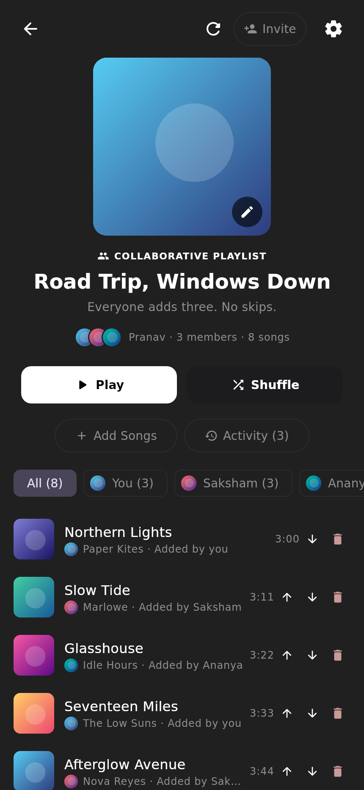
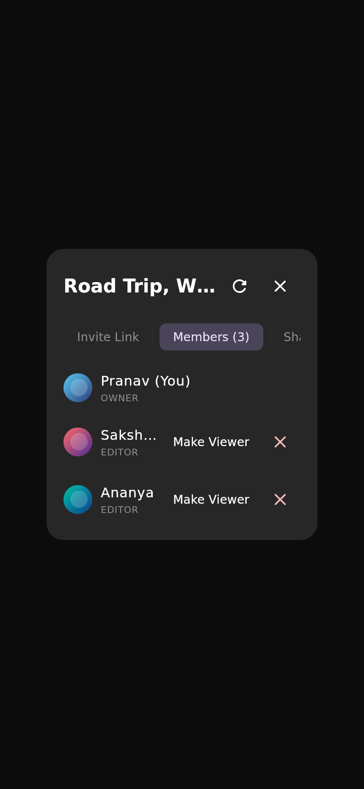
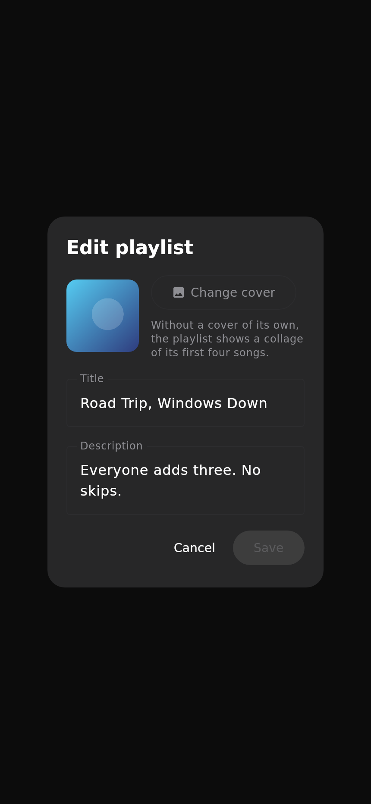

# BitChord PlusPC `v1.10.6` (`versionCode = 47`)

**Collaborative playlists that work end to end — Android, Android Auto, Android TV, Wear OS, macOS (Apple Silicon & Intel), Windows, Linux & Web**

This release replaces `v1.10.1` and carries everything from `1.10.1` through `1.10.6`.

  
  
  

---

## Collaborative playlists

### Sign in once, collaborate everywhere
- Your existing BitChord Google / YouTube Music sign-in is all it takes. No separate login, no OAuth client ID, no server to set up.
- Playlists are real YouTube Music collaborative playlists, so a friend can join from BitChord or from YouTube Music itself with the same `music.youtube.com/playlist?list=…&jct=…` link.
- A self-hosted collaboration server remains available under **Advanced** for those who want one.

### Joining works
- Accepting an invite no longer fails with a raw `HTTP 401` dialog. YouTube Music gives that answer both to an account that is already a collaborator and while a new link is still taking effect; BitChord now checks whether you actually have access and retries, instead of giving up on the first refusal.
- Opening a link you have already joined — from a second device, or after a reinstall — lets you straight in.
- When a join really is refused, you are told why in a sentence.
- **Any Google account can join.** An account that has never used YouTube has no YouTube channel, and YouTube Music refuses those as collaborators. BitChord now sets the channel up automatically while joining; where YouTube insists on its own setup screen, BitChord says so and takes you there.

### Make any playlist collaborative, with every song
- **Make Collaborative** now reads the whole source playlist, however long, rather than only the part that was on screen.
- Songs beyond the first fifty could be dropped silently while the new playlist was still being set up on YouTube Music's side. Every batch is now confirmed, and a song YouTube Music will not accept costs only that song — and is named.
- Converting a playlist you converted before adds whatever the shared copy is missing.
- Long collaborative playlists are listed in full.

### Faster and clearer
- Creating a collaborative playlist opens it immediately instead of after 15–25 seconds; its invite link is prepared in the background.
- **Copy Invite Link** is instant once the link exists.
- In **Add Songs**, song titles are readable on the dark theme, tapping `+` shows progress then a check (with haptics on phones), and the song appears in the playlist straight away.
- The owner can edit the playlist's **title, description and cover**. Until a cover is set, YouTube Music shows a collage of the first four songs.
- Removing a song, leaving a playlist and deleting one now **ask first**, with haptics and a confirmation afterwards, instead of happening the instant the icon is touched.
- The Invite / Members / Sharing tabs no longer wrap on narrow screens, and the member count follows who has actually joined.
- Open `music.youtube.com` playlist and invite links directly in BitChord on Android.

## Android
- **Playback controls on more phones**: BitChord now asks for the notification permission the first time something plays (it used to ask only at the first download). On Android 13+ several vendor skins build the lock-screen player and status-bar "island" from the media notification, which they hide from an app without that permission.
- Signed with the permanent BitChord PlusPC certificate (`SHA-256: d6d9c697c070a5ca5f4e172a13b6263fe2f3a35fff5d110596509126320c3bb2`); installs over `v1.10.x` in place.

## macOS
- The `.dmg`, `.pkg` and `.zip` are now **built on macOS** (`hdiutil`, `pkgbuild`, `codesign`). Earlier macOS packages were assembled on Linux by rewriting an older disk image and did not install; they should not be used.
- The app is ad-hoc signed and **not notarized by Apple**, so macOS asks for confirmation the first time:
  1. Open the `.dmg` and drag **BitChord** to **Applications** (or run the `.pkg`).
  2. Open BitChord once. macOS will refuse.
  3. Go to **System Settings → Privacy & Security**, scroll to the message about BitChord and choose **Open Anyway**.
  - Or, in Terminal: `xattr -dr com.apple.quarantine /Applications/BitChord.app`
- Pick `arm64` for Apple Silicon (M1 and later) and `x64` for Intel Macs.
- Every macOS package in this release was installed and launched on a Mac before publishing.

---

## Downloads
- **Android phone & Auto**: `BitChord-v1.10.6.apk` (universal) or the `arm64-v8a` / `armeabi-v7a` / `x86_64` build
- **Android TV / Fire TV**: `BitChordTV-v1.10.6.apk` or the per-ABI builds
- **Wear OS**: `BitChordWear-v1.10.6.apk` (also bundled in the phone app)
- **macOS**: `BitChord-1.10.6-macos-arm64.dmg` / `.pkg` / `.zip` (Apple Silicon), `BitChord-1.10.6-macos-x64.dmg` / `.pkg` / `.zip` (Intel)
- **Windows**: `BitChord-1.10.6-windows-x64-setup.exe`, `.msi`, `-portable.zip`
- **Linux**: `BitChord-1.10.6-linux-x86_64.AppImage`, `-linux-amd64.deb`, `-linux-x86_64.rpm`

Full history: [`CHANGELOG.md`](https://github.com/Inventor365/BitChord-PlusPC/blob/main/CHANGELOG.md)
